# Modèle de données

Schéma complet : `sql/carbure.sql` (MariaDB/MySQL, InnoDB, `utf8mb4`). Les évolutions
d'une base existante sont dans `sql/migrations/` et appliquées par `Migrator` (voir
[Migrations](#migrations)).

```mermaid
erDiagram
    users ||--o{ devices : "possède"
    users ||--o| user_mfa : "s'authentifie"
    users ||--o{ mfa_recovery_code : "secours"
    users ||--o{ mfa_trusted_browser : "fait confiance"
    users ||--o{ user_browser : "se connecte"
    users ||--o{ api_tokens : "possède"
    users ||--o{ user_notification : "choisit"
    users ||--o{ budget_alert : "alerté"
    bank_transaction_category ||--o{ budget_alert : "alerte"
    bank_transaction_category |o--o{ users : "budget surveillé"
    users ||--o{ budget_alert_threshold : "seuils"
    bank_transaction_category ||--o{ budget_alert_threshold : "seuil"
    users ||--o{ insight_alert : "alertes"
    budget_insight ||--o{ insight_alert : "alerte"
    users ||--o{ bank_account : "a ajouté"
    users ||--o{ bank_transaction : "rattachement"
    bank_transaction_category ||--o{ bank_transaction : "catégorise"
    bank_transaction_category ||--o{ bank_transaction_category : "parent"
    bank_transaction_category ||--o{ bank_transaction_category_keyword : "mots-clés"
    bank_transaction_category ||--o{ budget : "budgétée"
    bank_backend ||--o{ bank_account : "connexion"
    users ||--o{ bank_transaction_deleted : "a supprimé"
    oauth_clients ||--o{ oauth_codes : "reçoit"
    oauth_clients ||--o{ api_tokens : "obtient"
    users ||--o{ oauth_codes : "autorise"

    users {
        int id PK
        varchar username UK
        varchar password "bcrypt"
        varchar firstname
        varchar lastname
        varchar email UK
        tinyint is_admin
        varchar language "fr ou en"
        varchar theme "system, light ou dark"
        decimal alert_threshold "seuil d'alerte, NULL = désactivé"
        smallint budget_threshold "seuil des budgets en %, 100"
        tinyint budget_alert_category FK "budget surveillé, NULL = tous"
        tinyint budget_alert_all "seuil global activé, 1"
        datetime last_login
        tinyint failed_logins
        datetime locked_until "NULL = non bloqué"
    }
    devices {
        int id PK
        int user_id FK
        varchar name
        varchar token UK "token APNs ou FCM"
        varchar platform "ios, android"
        timestamp lastLogin
    }
    user_notification {
        int user_id PK
        varchar kind PK "sync, rule, expense, budget, insight"
        tinyint push "1 par défaut"
        tinyint email "0 par défaut"
    }
    budget_alert_threshold {
        int user_id PK
        tinyint category PK
        smallint threshold "seuil en %, 50 à 200"
    }
    budget_alert {
        int user_id PK
        tinyint category PK
        date month PK "premier jour du mois"
        decimal budget "budget alerté"
        decimal spent
        smallint percent
        datetime sent_at
    }
    api_tokens {
        int id PK
        int user_id FK
        varchar name
        char token_hash UK "SHA-256"
        varchar token_hint
        timestamp created_at
        datetime last_used_at
        datetime expires_at "NULL = sans expiration"
        varchar client_id "client OAuth, NULL = portail"
        char refresh_hash UK "SHA-256 du jeton de rafraîchissement"
    }
    oauth_clients {
        varchar client_id PK
        char client_secret_hash "NULL = client public"
        varchar name
        varchar redirect_uris "tableau JSON"
        timestamp created_at
    }
    oauth_codes {
        char code_hash PK "SHA-256"
        varchar client_id FK
        int user_id FK
        varchar redirect_uri
        varchar code_challenge "PKCE S256"
        datetime expires_at
    }
    bank_backend {
        varchar name PK "backend woob"
        varchar label "nom de la connexion"
    }
    bank_account {
        int id PK
        varchar bank_name "backend woob"
        varchar account_number
        varchar label "nom du compte, NULL = aucun"
        int user_id FK "qui l'a ajouté"
        datetime last_sync_at
        enum last_sync_status "OK, ERROR"
        varchar last_sync_message
    }
    bank_transaction {
        bigint id PK
        varchar uuid UK "md5(rdate, libellé, montant)"
        timestamp imported
        date date "indexée"
        date rdate "date réelle"
        tinyint type
        varchar label
        varchar comment "commentaire libre, NULL sans"
        tinyint category FK
        varchar category_source "origine : rule, manual, NULL inconnue"
        decimal amount
        varchar card
        varchar bank_name "banque d'origine"
        varchar account_number "compte d'origine"
        tinyint pointed "vérifiée"
        int user FK
    }
    bank_transaction_deleted {
        varchar uuid PK "ignorée à la synchronisation"
        timestamp deleted_at
        int user_id FK
    }
    bank_transaction_category {
        tinyint id PK
        varchar name UK
        tinyint parent_category FK
        enum type "DEBIT, CREDIT, HORS-BUDGET"
        varchar icon
        varchar color
    }
    bank_transaction_category_keyword {
        int id PK
        varchar keyword UK "unique avec amount"
        tinyint category FK
        decimal amount "valeur absolue, NULL : tous les montants"
        tinyint notify "notification au foyer"
    }
    budget {
        bigint id PK
        tinyint category FK
        decimal amount
        date date "1er du mois"
    }
    insight_alert {
        int user_id PK
        int insight_id PK
        enum direction "above, below"
        decimal threshold "montant, sans le signe"
        date notified_month "dernier mois alerté"
    }
    budget_insight {
        int id PK
        varchar name
        varchar color
        varchar icon
        varchar sql "requête avec {month} et {year}"
        tinyint enabled "affiché"
    }
    settings {
        varchar name PK
        varchar value
    }
    schema_migrations {
        varchar version PK
        timestamp applied_at
    }
```

## Tables

| Table | Rôle |
|---|---|
| `users` | Comptes. `is_admin` donne le profil administrateur ; `language` la langue du portail ; `theme` son thème (`system` : celui du système, `light`, `dark`) ; `alert_threshold` le montant à partir duquel une nouvelle dépense déclenche une notification (`NULL` = désactivé) ; `budget_threshold` le pourcentage du budget du mois d'une catégorie à partir duquel ses dépenses l'alertent (50 à 200, 100 par défaut) ; `budget_alert_category` la catégorie dont le budget est surveillé par ces alertes (`NULL` = tous les budgets, remis à `NULL` à la suppression de la catégorie) ; `last_login` la dernière connexion réussie ; `failed_logins` les échecs de connexion d'affilée et `locked_until` la fin du blocage (24 h après 5 échecs). |
| `devices` | Appareils mobiles (token APNs pour `ios`, FCM pour `android`, `platform` = `ios` par défaut), enregistrés à la connexion. Supprimés avec l'utilisateur, ou quand le service de notifications push signale leur token désinscrit. | Un appareil déjà enregistré pour un utilisateur le dispense de la double authentification.
| `user_mfa` | Double authentification d'un utilisateur : `secret` TOTP (base32), `enabled` (0 tant que l'enrôlement n'est pas confirmé par un premier code), `last_step` le dernier pas de temps accepté (un code ne sert qu'une fois). Supprimée avec l'utilisateur. |
| `mfa_recovery_code` | Codes de secours de la double authentification : seule l'empreinte SHA-256 (`code_hash`) est stockée, la ligne est supprimée à l'usage. Supprimés avec l'utilisateur. |
| `mfa_trusted_browser` | Navigateurs de confiance (6 mois) : empreinte SHA-256 du jeton du cookie (`token_hash`), `label` (User-Agent), `created_at`, `expires_at`, `last_used_at`. Supprimés avec l'utilisateur, quand son mot de passe change ou que sa double authentification est désactivée ou réinitialisée. |
| `user_browser` | Navigateurs web des connexions au portail : empreinte SHA-256 du jeton du cookie `carbure_browser` (`token_hash`, unique par utilisateur : plusieurs utilisateurs du foyer partagent le cookie d'un navigateur), `label` (User-Agent), `created_at`, `last_login`. Oubliés après 6 mois sans connexion ou à la demande de l'utilisateur, supprimés avec lui. Ni notification ni dispense de la double authentification. |
| `user_notification` | Canaux choisis par un utilisateur pour un type de notification (`kind` : `sync`, `rule`, `expense`, `budget`) : `push` vers ses appareils, `email` vers l'adresse de son profil. Sans ligne pour un type : push oui, email non, sauf `budget` (ni l'un ni l'autre). Supprimés avec l'utilisateur. |
| `budget_alert_threshold` | Seuil des alertes de budget d'un utilisateur pour une catégorie (`threshold`, de 50 à 200 %), à la place de son seuil global (`users.budget_threshold`, appliqué à tous les budgets si `users.budget_alert_all`). Supprimé avec l'utilisateur ou la catégorie. |
| `insight_alert` | Alerte d'un utilisateur sur un insight : `direction` (`above` ou `below`) et `threshold`, comparé à la valeur du mois sans son signe ; `notified_month` = premier jour du dernier mois alerté (`NULL` quand le seuil change : l'alerte est réarmée). Supprimée avec l'utilisateur ou l'insight, et quand l'insight est masqué. |
| `budget_alert` | Alertes de budget envoyées : une par utilisateur, catégorie et mois (`month`, premier jour), avec le budget (`budget`), les dépenses (`spent`) et le pourcentage (`percent`) au moment de l'alerte. Une nouvelle alerte ne part que si le budget du mois dépasse celui déjà alerté. Supprimées avec l'utilisateur ou la catégorie. |
| `api_tokens` | Jetons d'accès des agents IA (serveur MCP) : seule l'empreinte SHA-256 (`token_hash`) est stockée, `token_hint` (début du jeton) sert à le reconnaître ; `expires_at` `NULL` = sans expiration. Un jeton obtenu par OAuth porte son `client_id` et l'empreinte de son jeton de rafraîchissement (`refresh_hash`) ; `client_id` `NULL` = créé dans le portail. Supprimés avec l'utilisateur. |
| `oauth_clients` | Agents IA enregistrés par OAuth (RFC 7591) : `client_id`, empreinte du secret (`NULL` pour un client public, PKCE seul), nom et URI de retour autorisées (tableau JSON). |
| `oauth_codes` | Codes d'autorisation OAuth en attente (empreinte SHA-256, défi PKCE `S256`, 5 minutes, usage unique) ; supprimés avec leur client ou leur utilisateur. |
| `bank_backend` | Nom donné à une connexion bancaire (backend woob, ex. `bnp_2` → « Compte joint »), affiché à la place du nom de la banque ; sans ligne, le nom de la banque est affiché. Les identifiants restent chez woob. |
| `bank_account` | Comptes bancaires suivis par le foyer : `account_number@bank_name` forme le `bankId` passé à woob ; `label` est le nom donné au compte (« Compte joint », `NULL` = « BANQUE ···1234 »). `user_id` est l'utilisateur qui a ajouté le compte (« Ajouté par ») ; `last_sync_at`, `last_sync_status`, `last_sync_message` décrivent la dernière synchronisation. Unicité `(account_number, bank_name, user_id)` ; l'API refuse en plus un compte déjà suivi par le foyer. Un compte **manuel** (espèces, banque que woob ne gère pas) a le `bank_name` réservé `manual` : jamais synchronisé, ses transactions sont saisies à la main. |
| `bank_transaction` | Transactions. `uuid` unique sert au dédoublonnage ; `bank_name` et `account_number` indiquent le compte synchronisé d'origine (ou le compte lu dans un relevé importé, `bank_name` `NULL`), `NULL` pour les transactions enregistrées avant leur ajout ; `user` = premier utilisateur ayant ajouté le compte (`MIN(user_id)`), sans effet sur la visibilité ; suppression de l'utilisateur interdite tant qu'il a des transactions (`ON DELETE RESTRICT`) ; index `transaction_date` sur `date`. `split_of` = id de la transaction dont une **part** a été détachée (répartition sur plusieurs catégories ; la transaction garde le reste, supprimée avec ses parts) ; saisie à la main = `uuid` commençant par `manual` (jamais celui d'une banque, un md5 en
hexadécimal), ou `bank_name` `manual` (compte manuel, saisies antérieures). `category_source` = origine de la catégorie : `rule` (une règle), `manual` (choisie à la main, jamais écrasée par les règles), `NULL` (inconnue, catégorie posée avant son ajout). `comment` = commentaire libre du foyer (500 caractères, `NULL` sans commentaire), jamais écrit par la synchronisation ni l'import. |
| `tag` | Tags d'un projet limités dans le temps (`name` unique sans le `#`, `color`, `start_date`, `end_date` `NULL` = en cours), indépendants des catégories. |
| `transaction_tag` | Tags des transactions (`transaction_id`, `tag_id`) ; supprimés avec la transaction ou le tag. |
| `bank_transaction_deleted` | Transactions supprimées par un utilisateur (`uuid`, `deleted_at`, `user_id` mis à `NULL` si l'utilisateur est supprimé) : la synchronisation et l'import d'un relevé ignorent ces UUID, une transaction supprimée ne revient pas. |
| `bank_transaction_category` | Catégories hiérarchiques (`parent_category`, `0` = racine). La catégorie `0` « Non catégorisé » (`HORS-BUDGET`) est créée par l'installation et protégée. |
| `bank_transaction_category_keyword` | Règles : mots-clés (en majuscules) recherchés dans les libellés pour catégoriser automatiquement ; `notify` = chaque nouvelle transaction qui correspond est signalée au foyer. |
| `budget` | Budget d'une catégorie pour un mois (unique par catégorie et date), en `DECIMAL(10,2)`, avec une note facultative (`note`, 200 caractères). |
| `budget_insight` | Insights : requête SQL renvoyant une colonne `amount`, avec les marqueurs `{month}` et `{year}` remplacés par des entiers ; `icon` (icône Material, facultative) et `color` (13 couleurs) ; `enabled` = carte affichée (`0` : masqué, proposé par le bouton **+**, non calculé) ; `position` = place de la carte (tri par `position` puis `id`). |
| `settings` | Réglages modifiés depuis le portail (`mcp_enabled`). |
| `schema_migrations` | Migrations appliquées et leur date ; créée par `sql/carbure.sql` (version `2026-10-13_base`) ou par `Migrator`. La version du schéma est la dernière migration enregistrée. |

## Migrations

Les migrations de la version 1.0 (`2026-10-03_audit` à `2026-10-13_rule_notify` : droits
administrateur, alertes, `utf8mb4`, statut de synchronisation, jetons d'API, réglages,
dernière connexion, verrouillage, notification des règles) sont intégrées à
`sql/carbure.sql` et ont été retirées du dépôt. Une base créée depuis `sql/carbure.sql` a la
version `2026-10-13_base`.

Les migrations suivantes sont dans `sql/migrations/`, chacune avec sa ligne
`-- applied-if: <requête>`, qui permet de reconnaître une migration déjà appliquée (à la
main, ou par `sql/carbure.sql`). Voir [Développement](developpement.md#migrations-de-base).

| Migration | Changement |
|---|---|
| `2026-10-14_oauth` | OAuth des agents IA : tables `oauth_clients`, `oauth_codes`, colonnes `client_id` et `refresh_hash` de `api_tokens` |
| `2026-10-15_transaction_bank` | Banque et compte d'origine d'une transaction (`bank_transaction.bank_name`, `account_number`) |
| `2026-10-16_bank_account_label` | Nom donné à un compte suivi (`bank_account.label`) |
| `2026-10-17_bank_backend_label` | Nom donné à une connexion bancaire (table `bank_backend`) |
| `2026-10-18_transaction_deleted` | Transactions supprimées, plus réimportées (table `bank_transaction_deleted`) |
| `2026-10-19_user_theme` | Thème du portail (`users.theme`) |
| `2026-10-20_user_notification` | Canaux de chaque notification (table `user_notification`) |
| `2026-10-21_user_budget_threshold` | Seuil des alertes de budget (`users.budget_threshold`) |
| `2026-10-22_budget_alert` | Alertes de budget envoyées (table `budget_alert`) |
| `2026-10-23_user_budget_alert_category` | Budget surveillé par les alertes de budget (`users.budget_alert_category`, `NULL` = tous) |
| `2026-10-27_budget_alert_threshold` | Seuil global désactivable et seuils par catégorie des alertes de budget (`users.budget_alert_all`, table `budget_alert_threshold`) ; le budget surveillé devient un seuil de catégorie |
| `2026-10-30_transaction_split` | Répartition d'une transaction sur plusieurs catégories (`bank_transaction.split_of`) |
| `2026-10-31_tags` | Tags d'un projet limités dans le temps (tables `tag`, `transaction_tag`) |
| `2026-11-02_category_source` | Origine de la catégorie d'une transaction (`bank_transaction.category_source` : `rule`, `manual`, `NULL` inconnue) : les règles n'écrasent pas une catégorie choisie à la main |
| `2026-11-03_insight_alert` | Alertes des utilisateurs sur les insights (table `insight_alert`) |
| `2026-11-04_insight_largest_expense` | L'insight de départ « Plus grosse dépense » compte une transaction répartie une fois, avec le montant de la banque (seulement si sa requête n'a pas été modifiée) |
| `2026-11-19_transaction_comment` | Commentaire libre d'une transaction (`bank_transaction.comment`, `NULL` pour les transactions existantes) |

## Modèle « foyer »

Toutes les données (comptes, transactions, budgets, catégories, insights) sont partagées
par les utilisateurs. `bank_account.user_id` et `bank_transaction.user` indiquent qui a
ajouté le compte synchronisé, sans restreindre la visibilité. Seuls les appareils, les
jetons d'accès et les préférences (langue, thème, seuils d'alerte, canaux des
notifications, alertes de budget envoyées) sont propres à chaque utilisateur.

## Limites connues

- `budget_insight` stocke du SQL exécuté par le serveur : il est encadré (administrateurs
  seulement, mots-clés interdits, tables du budget seulement, transaction en lecture seule
  limitée à 5 secondes), mais des
  indicateurs définis dans le code seraient plus sûrs. Une requête d'insight écrite avec
  `MONTH(date)` / `YEAR(date)` n'utilise pas l'index sur les dates : préférer un intervalle.
